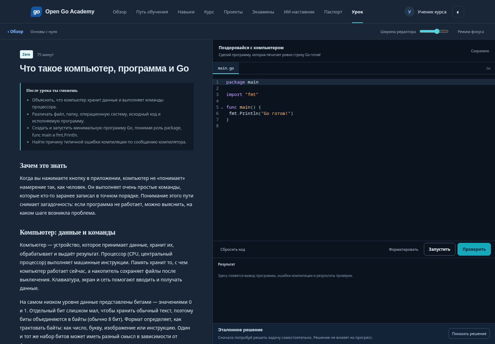
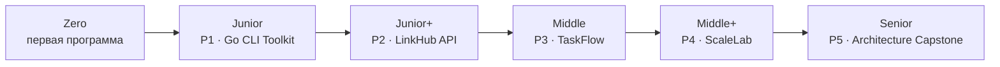
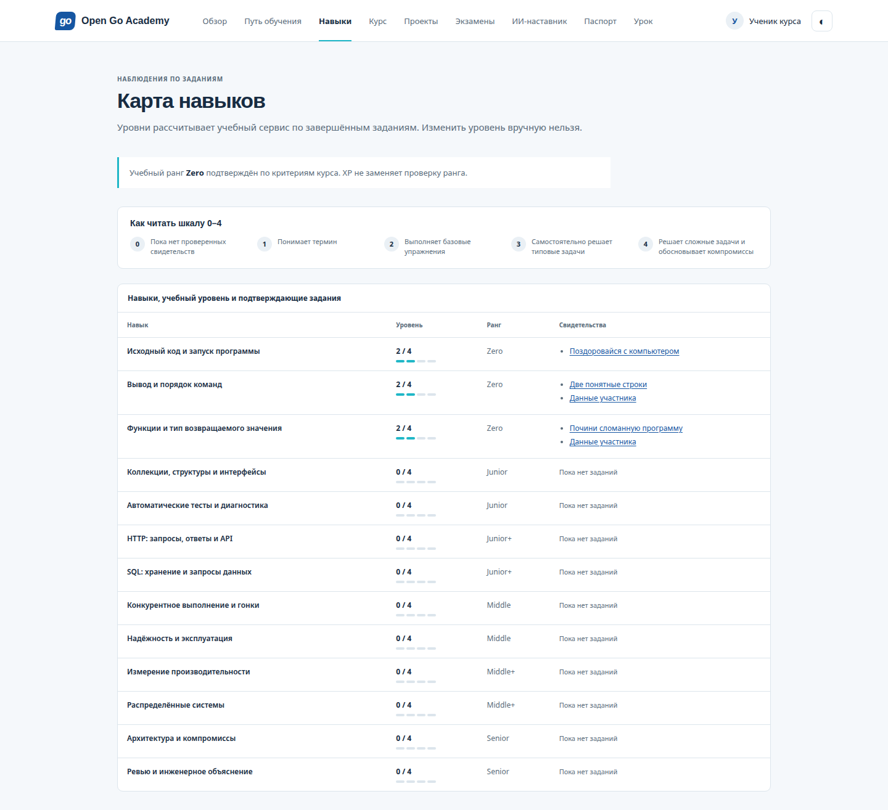
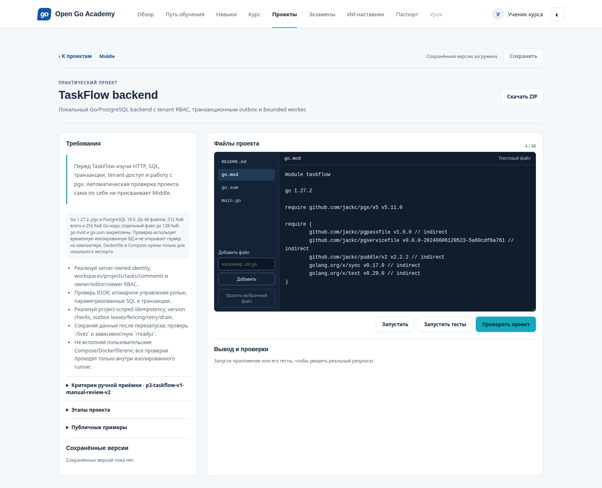
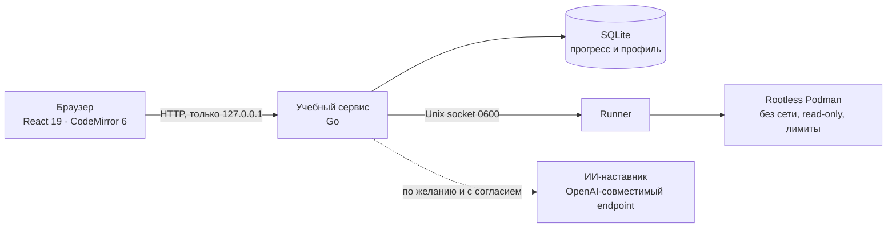

<div align="center">

# Open Go Academy

**Бесплатная платформа, где Go изучают с нуля до Senior — прямо в браузере, на русском, на своём компьютере.**

Урок → редактор → запуск кода в песочнице → автоматическая проверка → сохранённый прогресс.
Без регистрации, без подписок, без обязательного ИИ.

[](LICENSE)
[](COURSE_LICENSE.md)
[](go.mod)
[](web/package.json)
[](GETTING_STARTED.md)

[Быстрый старт](#-быстрый-старт) · [Путь обучения](#-путь-обучения) · [Как устроено](#-как-это-устроено) · [Статус](#-статус-проекта) · [Участие](#-участие)

<br>



</div>

---

## ✨ Что внутри

| | |
|---|---|
| 📚 **128 глав от Zero до Senior** | Объяснения для абсолютных новичков; английские термины сопровождаются переводом. |
| ⌨️ **Редактор прямо в уроке** | CodeMirror с подсветкой Go, форматирование, черновики сохраняются автоматически. |
| 🧪 **Настоящий запуск и проверка** | Код компилируется и выполняется в изолированном контейнере, тесты сразу показывают результат. |
| 🏗️ **Пять практических проектов** | От CLI-утилиты до архитектурного capstone — с файлами, версиями, ZIP и независимыми проверками. |
| 🎓 **Экзамены и карта навыков** | Ранг подтверждается выполненными заданиями, проектами и экзаменом, а не «опытом» на словах. |
| 🤖 **ИИ-наставник — по желанию** | Подключите локальную модель или облачный endpoint; без него весь курс работает полностью. |
| 🪪 **Паспорт и учебные credentials** | Подписанный документ о пройденных критериях с QR для локальной проверки. |
| 🌗 **Светлая и тёмная темы, мобильная вёрстка** | Проверено автотестами доступности (axe) на desktop и mobile. |

## 🧭 Путь обучения



| Ранг | Что осваиваете | Проект |
|---|---|---|
| **Zero** | Как работает программа, вывод, функции, первые ошибки компилятора | — |
| **Junior** | Коллекции, структуры, интерфейсы, автотесты и диагностика | **P1 · Go CLI Toolkit** — аргументы, файлы, тесты |
| **Junior+** | HTTP, API, SQL и хранение данных | **P2 · LinkHub API** — короткие ссылки и REST |
| **Middle** | Конкурентность, транзакции, надёжность | **P3 · TaskFlow** — Go/PostgreSQL backend с RBAC и outbox |
| **Middle+** | Измерение производительности, распределённые системы | **P4 · ScaleLab** — нагрузка и оптимизация |
| **Senior** | Архитектура, компромиссы, инженерное ревью | **P5 · Architecture & Systems Capstone** |

> [!NOTE]
> Ранг подтверждает критерии курса Open Go Academy. Это не должность, не стаж и не аккредитация. Автоматические проверки не заменяют ручное архитектурное ревью — продвинутые ранги требуют отдельного доверенного ревью.

<table>
<tr>
<td width="50%"></td>
<td width="50%"></td>
</tr>
<tr>
<td align="center"><sub>Карта навыков считается по выполненным заданиям — вручную её не поменять</sub></td>
<td align="center"><sub>Проект TaskFlow: файлы, тесты и независимая проверка в песочнице</sub></td>
</tr>
</table>

## 🚀 Быстрый старт

**Нужно:** Linux, Node.js 24 LTS, npm, make и **rootless Podman** (cgroup v2, systemd, seccomp) для запуска учебного кода. Go ставить заранее не обязательно — `make bootstrap` скачает закреплённую версию 1.27.2. Проверенная среда: Fedora 44, Podman 5.8.7.

```sh
git clone https://github.com/hikkian/open-go-academy.git
cd open-go-academy
make bootstrap   # Go toolchain, npm-пакеты, Chromium для тестов, образ песочницы
make build
```

Затем в двух терминалах:

```sh
make runner      # изолированный исполнитель кода
```

```sh
make dev         # учебный сервис и интерфейс
```

Откройте **http://127.0.0.1:8380**, введите имя — и первый урок готов. Когда исполнитель запущен, он сообщает `local runner ready`.

> [!TIP]
> Если песочница недоступна (нет нужных возможностей системы), запуск кода просто отключается — уроки, черновики и прогресс продолжают работать. Небезопасного «запуска без песочницы» нет намеренно.

Подробнее: [GETTING_STARTED.md](GETTING_STARTED.md). Экспериментальные, пока не проверенные маршруты: [Windows через WSL 2](docs/INSTALL_WINDOWS_WSL.md) и [macOS через Linux VM](docs/INSTALL_MACOS.md).

## 🧩 Как это устроено



| Часть | Технологии |
|---|---|
| Интерфейс | React 19, TypeScript, Vite, CodeMirror 6 (`@codemirror/lang-go`) |
| Сервис | Go 1.27, SQLite, миграции применяются автоматически |
| Песочница | rootless Podman: образ по digest, uid 65532, read-only root, `network none`, drop capabilities, seccomp, cgroups, ограниченный tmpfs |
| Проекты | отдельный project-runner со своими зафиксированными образами SDK и проверок |
| Проверки | Go tests, Playwright (desktop/mobile, светлая/тёмная, axe), sandbox-пробы памяти/PID/вывода/диска |

Решения и модель угроз: [обзор архитектуры](docs/architecture/OVERVIEW.md) · [выбор стека](docs/architecture/ADR-0001-tech-stack.md) · [модель угроз](docs/architecture/THREAT_MODEL.md).

## 🔒 Безопасность и приватность

- Сервис слушает **только loopback** — это локальная установка для одного владельца компьютера.
- Пользовательский код выполняется **только** в изолированном контейнере без сети. Контейнер делит ядро с системой: это защита учебного режима, а не публичного многопользовательского сервиса.
- ИИ-наставник выключен по умолчанию. Каждый запрос требует отдельного согласия; код, диагностика и прогресс отправляются только если вы это явно разрешили. История диалога на сервере не хранится.

Сообщить об уязвимости: [SECURITY.md](SECURITY.md).

## 📊 Статус проекта

Этапы M0–M13 приняты, исходники опубликованы.

- ✅ Сквозной сценарий «урок → редактор → запуск → проверка → прогресс» работает.
- ✅ Опубликованы 128 глав (Zero → Senior) и 120 упражнений первых трёх рангов.
- ✅ Рабочие места P1–P5, экзамены и сбор подтверждений для шести рангов, паспорт и credentials.
- ✅ Техническая приёмка 88 глав Middle → Senior пройдена.
- ⏳ Полная педагогическая проверка и процессы управления курсом ещё открыты.
- ⏳ Windows и macOS не проверены; публичный многопользовательский запуск кода не поддерживается.

Живая панель: [прогресс проекта](docs/PROJECT_PROGRESS.html) · [план](docs/EXECUTION_PLAN.md) · [отчёт о проверках](docs/VALIDATION_REPORT.md) · [журнал изменений](CHANGELOG.md).

## 🛠️ Для разработчиков

```sh
make test                          # Go-тесты и проверки
make sandbox-test                  # пробы лимитов песочницы
python3 scripts/crash-check.py
make e2e                           # Playwright; нужен запущенный make runner
```

Без `ACADEMY_E2E_RUNNER` команда `npm run e2e` проверяет чтение и редактор и явно пропускает запуск кода. Артефакты тестов складываются в `artifacts/` (в Git не попадают). Как писать главы и задания: [COURSE_AUTHORING.md](docs/COURSE_AUTHORING.md).

<details>
<summary><b>Данные, резервные копии и обновление</b></summary>

<br>

Профиль и прогресс хранятся в `.data/academy.db`; там же Unix socket, приватный `session.secret` и ключ подписи учебных credentials `issuer.key`. Остановка — `Ctrl+C`.

Для полной резервной копии остановите сервис и сохраните в закрытом месте **весь** каталог данных `.data/` (как минимум `academy.db`, `session.secret` и `issuer.key`). Если путь данных изменён конфигурацией, копируйте соответствующий каталог целиком. Ключ `issuer.key` нужен для проверки уже выданных credentials: при его потере старт блокируется, а новый ключ старые записи не переподписывает — восстановите оригинал из резервной копии. Храните копию как секрет и проверьте восстановление на отдельной копии данных.

При обновлении базу не удаляйте: миграции применяются автоматически. Cookie локальной установки не является проверкой личности.

</details>

<details>
<summary><b>ИИ-наставник: подключение и бюджет</b></summary>

<br>

Весь курс работает без ИИ. Чтобы подключить **локальную модель**, укажите в настройках наставника OpenAI-совместимый loopback endpoint и имена моделей — конфигурация без ключа сохраняется в `.data/tutor-provider.json` (права 0600). Сохранение не вызывает модель. Альтернатива — переменные `ACADEMY_AI_ENDPOINT` (полный URL `/v1/chat/completions`) и `ACADEMY_AI_MODEL` с перезапуском сервиса; пример — `.env.example` (файл `.env` автоматически не читается). Шлюз отправляет `max_completion_tokens`, не выполняет model discovery и не скачивает модели — совместимость конкретной модели проверьте сами.

Дополнительно: `ACADEMY_AI_ADVANCED_MODEL` для режимов review/interview/architecture/deeper, `ACADEMY_AI_FALLBACK_MODEL` после ошибки основной модели, `ACADEMY_AI_PROVIDER_LOCATION=local|cloud|unknown` (по умолчанию `unknown`).

**Облачный endpoint** подключается в интерфейсе по HTTPS; ключ хранится только в `.data/tutor-cloud-provider.json` (0600) и не возвращается браузеру. Для переменных облачного провайдера из окружения нужен `ACADEMY_AI_ALLOW_CLOUD=true`. API-ключ OpenAI оплачивается отдельно от ChatGPT/Codex ([разъяснение](https://help.openai.com/en/articles/9039756-managing-billing-for-chatgpt-and-the-api-platform)). Облачные адреса проходят проверки HTTPS/публичного IP, IP закрепляется при настройке, redirects и proxy-переменные отключены. Смена конфигурации делает прежнее согласие недействительным.

**Бюджет:** `ACADEMY_AI_DAILY_TOKENS` (по умолчанию 100 000, максимум 1 000 000 в сутки по UTC). Перед запросом резервируется оценка запроса, максимального ответа и до трёх вызовов; при успехе списывается фактический расход. Это лимит токенов, а не цены — тариф контролирует провайдер.

**Контекст:** до 56 КиБ текста опубликованного курса (выбранная глава и до двух подходящих). Черновики, эталонные решения, graders и ответы self-check не отправляются. Код (`share_code`), диагностика запуска до 4 КиБ (`share_diagnostics`) и серверная сводка прогресса (`share_progress`) — только с отдельным согласием. Проверьте контекст на секреты: маскирование неполное. Ответ модели не меняет XP и ранг.

Тест без LLM и без денег: `python3 scripts/tutor-test-provider.py`, затем
`ACADEMY_E2E_TUTOR=1 ACADEMY_AI_ENDPOINT=http://127.0.0.1:8095/v1/chat/completions ACADEMY_AI_MODEL=economy-test ACADEMY_AI_FALLBACK_MODEL=fallback-test ACADEMY_AI_DAILY_TOKENS=45000 npm run e2e -- --grep tutor`.

</details>

<details>
<summary><b>Паспорт и учебные credentials</b></summary>

<br>

После подтверждённого экзамена раздел «Паспорт» выпускает документ с именем или псевдонимом. По умолчанию он приватен; публикация credential и паспорта включается раздельно, с согласием. Проверка `/verify/:id` доступна без входа только для опубликованной записи; отзыв показывает revoked, снятие с публикации возвращает 404. Уже скачанные копии удалить невозможно.

JSON `oga-local-v1` подписан ключом Ed25519 из `.data/issuer.key`; PDF и PNG визуализируют результат и содержат QR локальной проверки (отдельной цифровой подписи PDF нет). Подпись не доказывает личность, должность, опыт или аккредитацию, а самостоятельная установка — не доверенный внешний эмитент. Соответствие Open Badges/W3C VC не заявляется. Для независимой проверки закрепите ожидаемый fingerprint ключа доверенным способом. `ACADEMY_ISSUER_KEY` позволяет указать другой приватный путь к ключу.

</details>

<details>
<summary><b>Исполнитель проектов (P2 LinkHub и далее)</b></summary>

<br>

После базовой установки:

```sh
make project-runtime   # локальные образы SDK и проверок, закреплённые Go-зависимости
make project-runner    # отдельный процесс; держите запущенным вместе с сервисом и runner
```

SDK содержит только разрешённые зависимости из закреплённых `go.mod`/`go.sum`; проверяющая программа живёт в другом образе, эталонная логика в SDK не входит. Метаданные образов хранятся в `.data/p2-runtime` (0600). Отсутствующий образ не скачивается автоматически; для PostgreSQL нужен заранее загруженный образ по digest — см. [исследование P2](docs/research/P2_LINKHUB.md).

В разделе «Проекты» доступны файлы, версии и ZIP. «Запустить» проверяет готовность во временной среде без открытия порта на компьютере, «Запустить тесты» — Go-тесты, «Проверить проект» — независимые HTTP-проверки и сохранение данных после перезапуска. Dockerfile/Compose из редактора — только для экспорта. Не запускайте Compose-файлы проектов через Docker/Podman хоста.

Дополнительные проверки разработчика:

```sh
python3 scripts/p2-reference-check.py
python3 -m venv .tools/qa-python
.tools/qa-python/bin/pip install -r scripts/qa-requirements.txt
.tools/qa-python/bin/python scripts/p2-schema-check.py
python3 scripts/p2-worker-check.py
python3 scripts/p2-worker-recovery-check.py
ACADEMY_E2E_PROJECT_RUNNER=1 npm run e2e -- --grep 'P2 real isolated'
```

Ранги Junior/Junior+ по автоматическим критериям v1.0.0 требуют всех упражнений программы, предыдущего ранга, функциональных проверок P1/P2 и экзамена; ручное качество проекта ими не подтверждается. Тест native-цепочки:
`ACADEMY_EXAM_CATALOG_NATIVE=1 sh scripts/go.sh test -count=1 -timeout=10m -run TestNativeJuniorAndJuniorPlusAssessmentChain -v ./internal/httpapi`.

</details>

## 🤝 Участие

Исправления в курсе, задания, тесты и код приветствуются. Начните с [CONTRIBUTING.md](CONTRIBUTING.md) и [руководства автора курса](docs/COURSE_AUTHORING.md). Учебный код и эталонные решения обязаны компилироваться и проходить тесты.

## 📄 Лицензии

- **Код**, тесты, скрипты и исполняемые примеры — [MIT](LICENSE).
- **Учебные тексты**, задания, глоссарии и иллюстрации — [CC BY 4.0](COURSE_LICENSE.md).
  Рекомендуемая атрибуция: «Учебные материалы подготовлены проектом Open Go Academy (2026)».
- Сторонние компоненты сохраняют свои лицензии: [NOTICE](NOTICE), [THIRD_PARTY_NOTICES.md](THIRD_PARTY_NOTICES.md), [перечень лицензий](docs/validation/m13-license-inventory-e2bad43-20261018.json) (фиксирует метаданные и не заменяет проверку прав и обязательств).

<div align="center">
<br>
<sub>Курс бесплатный и открытый: не требует платного ИИ, внешнего аккаунта или подписки.</sub>
</div>
