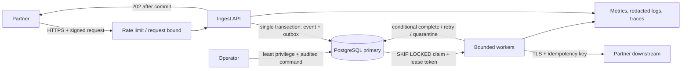

# Reference system design — EventLedger

## Краткое решение и границы

Сценарий: принимать partner order events с replay, изоляцией организаций и внешним side effect. Ответ `202 Accepted` допустим только после долговечного commit. Приём не ждёт downstream. Система гарантирует durable acceptance и at-least-once попытки доставки внутри выбранного retention; exactly-once эффект не заявляется для произвольного downstream. Пока продуктовые неизвестные не подтверждены, это условное решение для одного региона, одного PostgreSQL primary и очереди внутри БД, без обещания multi-region availability.

Вне scope: клиентский UI, универсальная шина событий, произвольные плагины, автоматическое исправление бизнес-данных, cross-region active-active. Заказы не содержат платёжных реквизитов. Если discovery подтвердит такой payload, граница хранения/шифрования и retention должна быть пересмотрена до запуска.

## Requirement register (пример, все значения — гипотезы до владельца)

| ID | Требование / допущение | Acceptance и проверка |
|---|---|---|
| FR-1 | Приём события возвращает accepted только после commit envelope + outbox | Убить процесс после commit и до HTTP response; повторный idempotency key не создаёт второй logical event |
| FR-2 | Tenant выводится из проверенного partner credential, не из body | API negative tests: поддельный tenant ID не читает и не создаёт чужую строку |
| FR-3 | Повтор одинакового key/hash — тот же receipt; тот же key с другим hash — conflict | Параллельный integration test на уникальном `(tenant_id, idempotency_key)` |
| NFR-1 | Гипотеза: durable acceptance p99 < 300 ms при 500 req/s в 15 минут | Фиксированный workload, размер body и hardware в отчёте; не общий SLA |
| NFR-2 | Гипотеза: 99.9% событий завершаются за 5 минут в месяц | Измерять committed time → terminal delivery, отдельно исключать согласованные окна |
| NFR-3 | Гипотеза: RPO ≤ 5 минут, RTO ≤ 60 минут | Backup/restore exercise в целевой среде; если backup asynchronous и хуже — цель пересогласовать |

Вопросы заказчику: регион и compliance; реальные peak/burst; размер/доля больших событий; окно replay партнеров; порядок на ключ; downstream idempotency; retention/deletion/audit; допустимая деградация; budget/team/on-call. Владелец утверждает каждую гипотезу перед SLO publication.

## Контекстная и потоковая схема

`202` occurs after commit, never after in-memory enqueue. Transaction inserts the idempotency record and outbox item together. Worker claims a row by conditional update with an incrementing fencing token and bounded lease, commits claim, then performs network I/O outside the transaction. On success it records a receipt and marks complete only where the current token still matches. After lease expiry, a newer token fences the paused worker. The external call uses stable event ID as downstream idempotency key; if the receiver cannot deduplicate, retries may duplicate an irreversible effect and reconciliation is mandatory.

## Data and contracts

`event`: `(tenant_id, event_id)` primary key, idempotency key scoped by tenant, payload hash, schema version, accepted_at, retention_until. `outbox`: event reference, state, available_at, attempt, lease_owner, lease_until, fence_token, last_error_code. `delivery_receipt`: unique `(tenant_id, event_id, destination, effect_version)`, outcome and completion time. Foreign keys include tenant ID where possible. Payload is encrypted at rest by the chosen database/storage service and access is limited to API/worker roles; secret values never appear in logs.

API input is strict, bounded, versioned JSON with a cryptographically verified partner signature over raw bytes, timestamp and nonce. Server maps credential to tenant. Oversized/unknown schema is rejected. Responses include opaque event ID and state URL; diagnostics are correlated with an unguessable request ID, not customer payload.

Invariants: (1) accepted means event+outbox committed; (2) one tenant-scoped idempotency key maps to one payload hash; (3) only current fence can commit worker result; (4) each downstream destination/version has at most one recorded receipt; (5) tenant predicates are mandatory; (6) delete/retention applies to payload, while minimal tombstone may remain only for an explicitly approved audit period.

## Failure model

| Failure point | Observable state | Recovery |
|---|---|---|
| Before transaction commit | No accepted event | Client retries same idempotency key |
| Commit succeeds, response lost | Event exists; client uncertain | Retry resolves to prior receipt, no duplicate enqueue |
| Worker crashes before call | Lease expires, item retried | Claim with larger token |
| Downstream commits, response lost | Effect may exist, local receipt missing | Retry stable downstream idempotency key; otherwise reconciliation/manual decision |
| Old worker resumes after reassignment | Old fence no longer current | Conditional complete fails; stale worker records no success |
| Poison schema or repeated 4xx | Bounded retries exhausted | Quarantine/DLQ with reason code; redrive only after correction and approval |
| DB unavailable/full | Ingest rejects/backs off; never lies with accepted | Alert on availability and disk; restore capacity, then clients replay |
| Noisy tenant | Shared pool pressure | Per-tenant quotas, fair scheduling and admission backpressure |

Ordering is intentionally not guaranteed across event IDs in initial release. If the domain requires per-order order, partition/sequence and gap policy are a prerequisite; do not infer it from FIFO claim order.

## Capacity model (illustrative, must be measured)

Assumptions for a staging exercise only: average 100 events/s, peak 500/s for 15 minutes, mean serialized payload 4 KiB, 7-day payload retention, 2x allowance for indexes/row overhead, 3 replicas including primary, retry multiplier 1.2. Ingest payload rate: `500 × 4 KiB = 2,000 KiB/s ≈ 1.95 MiB/s`. Peak 15-minute payload volume: `500 × 900 × 4 KiB ≈ 1.72 GiB`; seven-day average payload: `100 × 604,800 × 4 KiB ≈ 230.4 GiB`, before overhead. With 2x row/index allowance and three copies the rough storage envelope is about 1.35 TiB. This is deliberately a warning to validate retention and storage cost, not a capacity promise.

Worker count is derived only from measured stable throughput: `workers = target events/s ÷ measured events/s per worker × retry multiplier`; measure at realistic latency and cap DB connections. Load test records hardware, DB config, payload distribution, concurrency and p50/p95/p99; test one peak period plus recovery catch-up. Partitioning/sharding is deferred until measured bottleneck and recovery exercise justify migration.

## Security and privacy decisions

Partner signatures use rotating credentials held in a secret manager; verification is over raw request body and timestamp window, with replay nonce persisted for the window. API rejects requests when tenant quotas or body limit are exceeded. Roles separate ingest, worker, read-only support, and migration. Admin access is audited. Metrics use bounded labels, never tenant IDs as unbounded labels or payload values. Logs carry event ID and redacted failure class only. Retention, deletion, residency and encryption-key lifecycle require owner sign-off before production.

## Review and unclosed questions

This is a plausible single-region baseline, not proof that one PostgreSQL cluster meets the unknown workload. A qualified reviewer should challenge the capacity assumptions, point-in-time restore, downstream idempotency and tenancy boundary. A rank decision additionally requires the platform's independent authenticated human review record on the exact artifact hash; this reference document cannot generate such a record.
