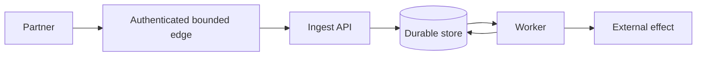

# System architecture — шаблон

## Диаграмма

Нарисуйте компоненты и trust boundaries. На стрелках укажите протокол, identity, синхронность, retry/timeout и commit point. Отдельно покажите путь при отказе и восстановлении; не используйте только коробки без потоков.

Это только заглушка-эскиз — замените её своей схемой и подпишите границы/состояния.

## Контракты и инварианты

- API/event schema and versioning:
- Identity → tenant resolution:
- Idempotency key scope and conflict behavior:
- Ordering guarantees and gaps:
- Retention, deletion and audit trail:
- Migration and compatibility strategy:
- Invariant → implementation mechanism → falsifying test:

## Failure-state table

| Fault point | Durable state | Client/operator observation | Recovery and duplicate risk |
|---|---|---|---|
| | | | |
